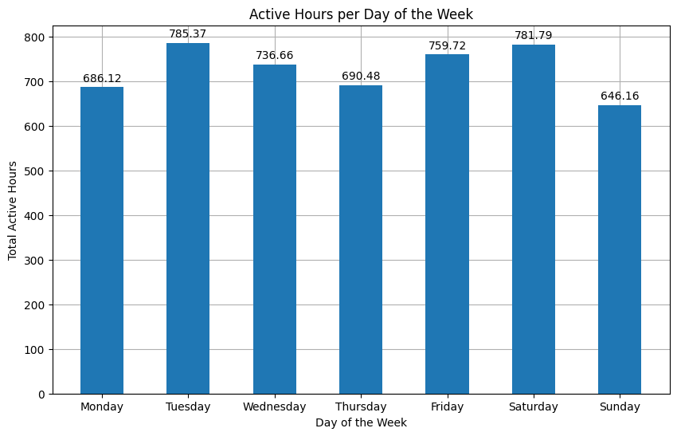
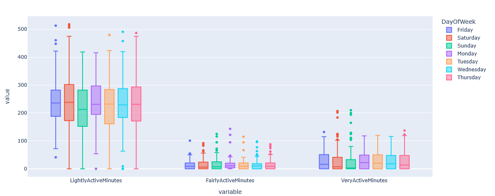
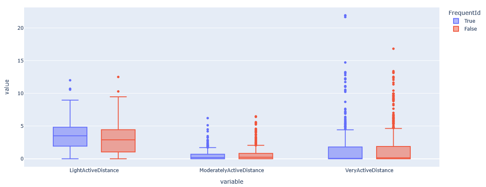

## Google Data Analytics Capstone Project

You have been asked to focus on one of Bellabeat’s products and analyze smart device data to gain insight into how consumers are using their smart devices. 
The insights you discover will then help guide marketing strategy for the company. You will present your analysis to the Bellabeat executive team along with 
your high-level recommendations for Bellabeat’s marketing strategy.

1. What are some trends in smart device usage?
2. How could these trends apply to Bellabeat customers?
3. How could these trends help influence Bellabeat marketing strategy?

### Case Study Roadmap - Ask 

The business task is to guide the marketing strategy for the company through recommendations based on actual data from users. Through the 
insights a new campaign can be created with higher chances of positive outcomes since it considers real life information.

### Case Study Roadmap - Prepare

My data is organized as CSV files in the Kaggle website, as well as a copy of it in a local drive. The information in it was offered voluntarily by users 
with their consent in order to be used for analysis. It is reliable, original and credible, but it is not current nor is it complete, since there are many
files with missing information and it contains data from 10+ years ago. Two datasets were concatenated to get the full data available between the dates
'2016-03-12' and '2016-05-12'.

### Case Study Roadmap - Process

I am using Python with libraries such as Pandas, NumPy, MatPlotLib, Plotly and Seaborn. I have verified the data's integrity by assessing the information
available through several lines of code, such as: checking for duplicated values; validating data types for columns; changing date columns to adhere to a
single format; guaranteeing that columns with total minutes didn't surpass logical values (1440 for a total day); documenting the cleaning process; and
protecting the dataset from unauthorized changes to maintain security. 

### Case Study Roadmap - Analyze and Share

New columns were created in order to better present the information. 'TotalActiveMinutes' is the sum of all different levels of activity whereas 'TotalMinutes' 
is the sum of the 'TotalActiveMinutes' and the 'SedentaryMinutes'. Through those metrics I was also able to calculate the hours equivalent of the columns 
in order to present the data in a different scale. 

A 'DayofWeek' column was included to analyze whether the users preferred exercising on particular days, which proved to be true as Monday (188) is the day with least 
entries and Tuesday (225) is the most common day for exercising. Perhaps coming off the weekend makes it harder for people to get into the rhythm of activity.

Interestingly enough, the 'VeryActiveDistance' median is at its highest on Mondays, which is probably attributed to advanced users that have been regularly 
exercising for some time and do not break from their routine. Total Distance median is at its highest throughout the weekdays, leaving Sunday to be the day 
with the lowest distance across all categories, often a day of rest. When it comes to adding the distances instead of using their median, Tuesdays and
Saturdays come first in both TotalActiveMinutes and TotalDistance.

When analyzing the active hours, Tuesdays and Saturdays have the highest amount of total active hours with a total of just over 780. Something to pay attention
to is the number of active hours on Thursdays, since they have one of the lowest total of active hours while still having the second highest total distance in 
kilometers.

Usually LightlyActiveMinutes and LightlyActiveDistance corresponds to the same ranking, or quite similar, of TotalActiveMinutes and TotalDistance, respectively.
This probably points to a user base that exercises within a lower exertion range, which can be visualized in the following table:

| Id | LightlyActiveMinutes | FairlyActiveMinutes | VeryActiveMinutes | 
| --- | --- | --- | --- |
| 2026352035 |	99.89 |	0.08 |	0.03 |
| 1844505072 |	98.88 | 0.88 |	0.23 |
| 6117666160 |	98.69 |	0.87 |	0.44 |
| 2320127002 |	98.13 |	1.19 |	0.68 |
| 1927972279 |	96.76 |	1.68 |	1.56 |
| 4445114986 |	96.45 |	0.69 |	2.86 |
| 3372868164 |	95.75 |	1.19 |	3.06 |
| 8792009665 |	94.91 |	4.07 |	1.03 |
| 6290855005 |	94.91 |	2.95 |	2.15 |
| 2873212765 |	94.42 |	1.92 |	3.66 |

*(reduced to top 10 for visualization)*

A total of 9 users had a "LightlyActiveMinutes" percentage under 80, with the lowest being 56. This means it's more common to practice activities lightly.

There were only two instances of individual logs under ten minutes, both under 50 steps. These might have been particular instances of starting or finishing 
an exercise that wasn't added correctly by the watch. Only seven users used the 'LoggedActivitiesDistance' function, which is likely instances of exercising 
that the user added manually since they might not have had their watch or method of logging/measuring with them.

| Id | Count |
| --- | --- |
| 8378563200 | 23
| 7007744171 | 19
| 6962181067 | 7
| 2891001357 | 3
| 6391747486 | 2
| 4057192912 | 1
| 6775888955 | 1

With the median TotalActiveHours being 160, a boxplot was created to better understand the behavior of most active half of the users according to day of the week
and with hover data allowing to see if they were Frequent Users, that is a user that logged at least 43 times during the time studied, or not.

Often the outliers were not frequent users, which can possibly mean situations in which some users would forget or skip days of exercise then try to compensate
by doing longer exercises. Many of the outliers for the highly active minutes are during the weekend, which perhaps means a lack of time to exercise during the
week and trying to do longer training days during free time.

An analysis was made with focus on these Frequent Users, but there was not much difference between their type of distance even in amount of outliers.

What can be seen is a larger amount of outliers for frequent users in their total distance.

### Case Study Roadmap - Share

● Most users train in a Light Active rhythm, for both time and distance. It'd be interesting to suggest other light training programs or even higher intensity (moderate) for these users;
● Advertise towards Light Active exercises since they're less intimidating for new users, introducing articles to show the benefits of different training intensities;
● Get data to see the percentage of premium users so the app can be improved with the average user in mind
